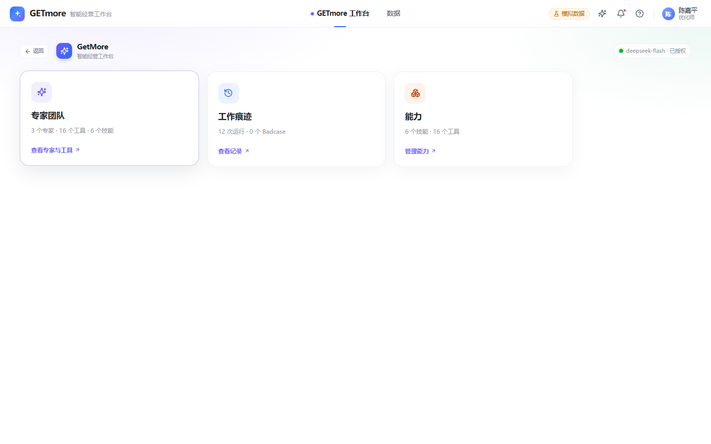
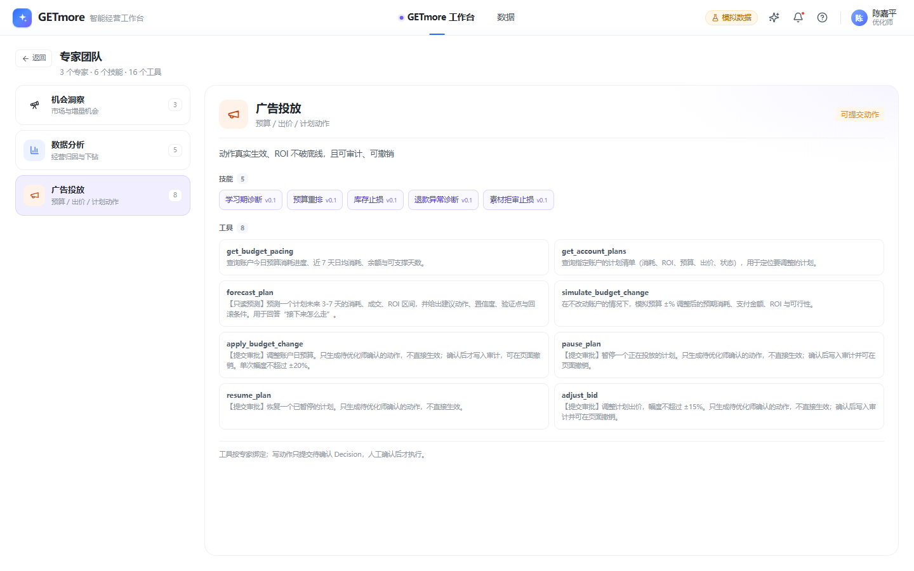
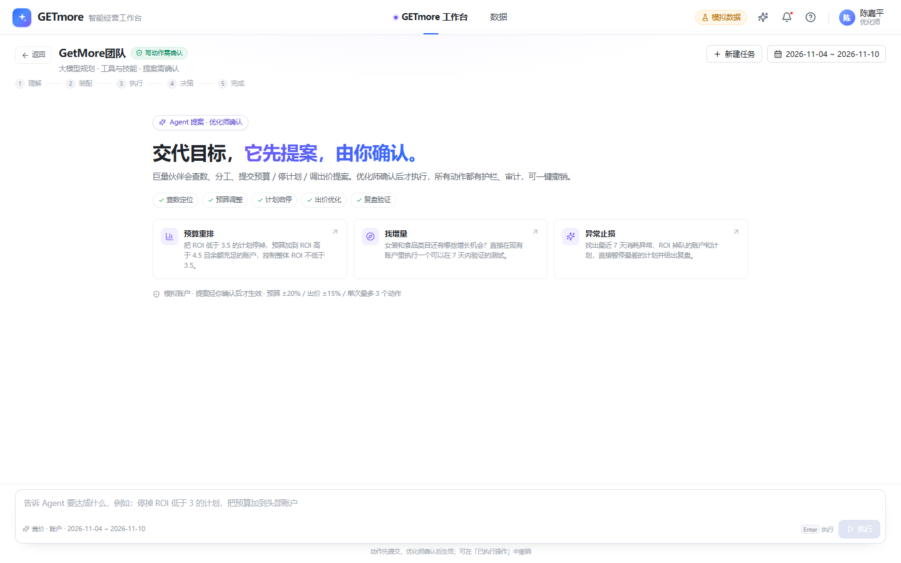
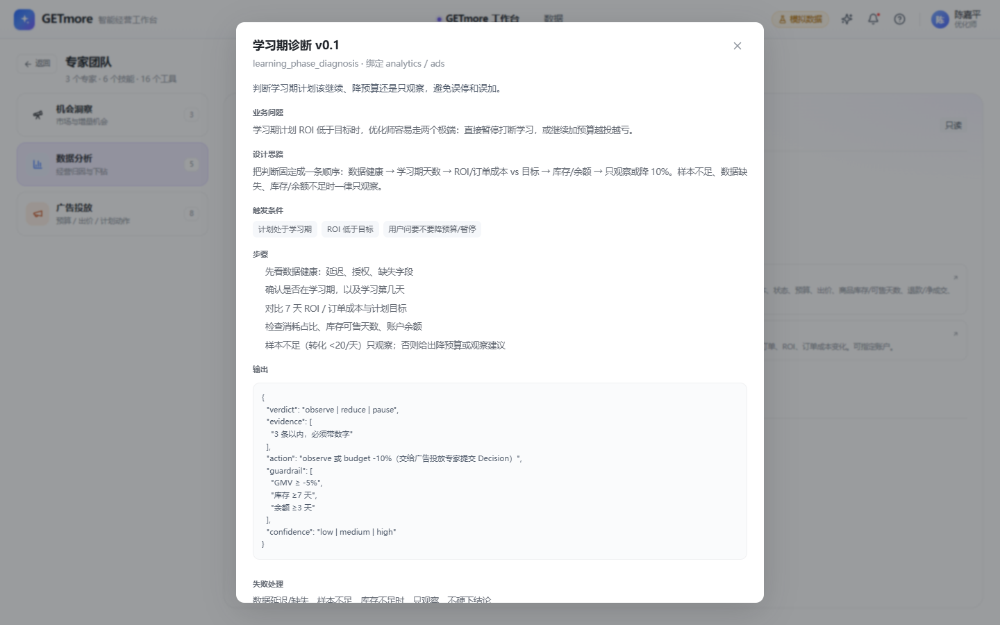
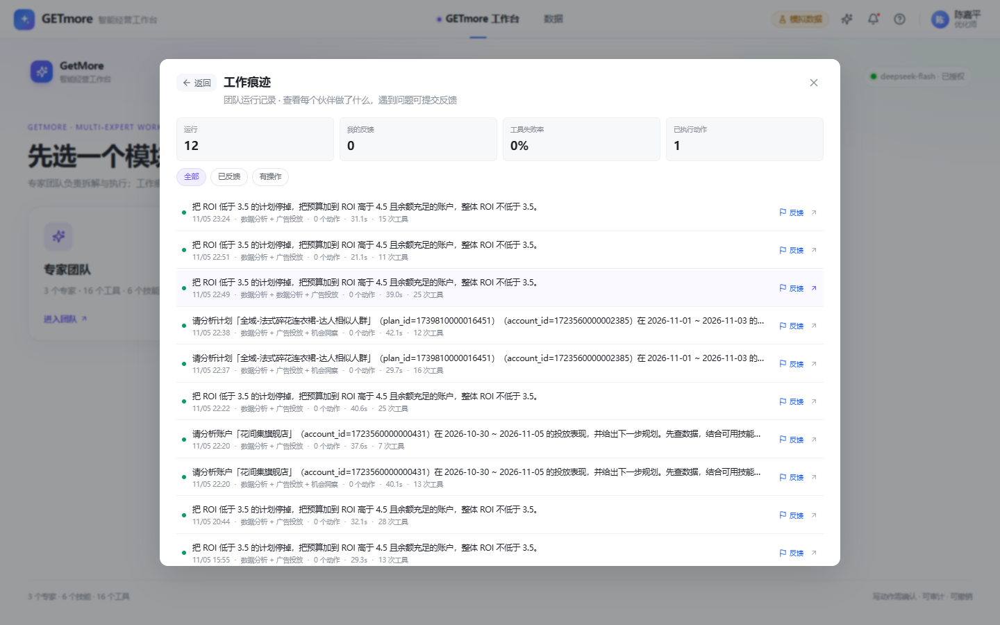
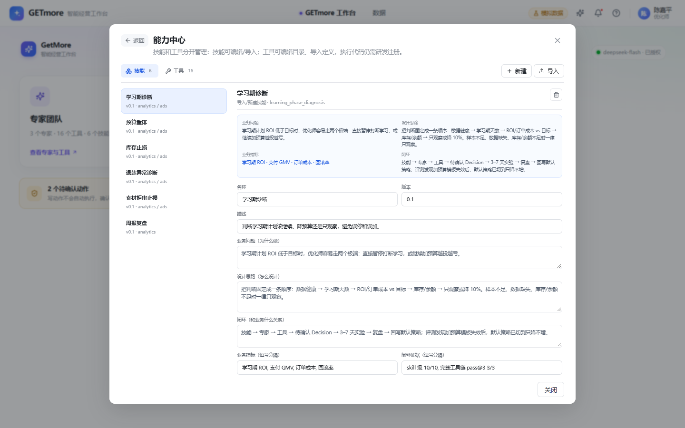

# GETmore 智能经营工作台

> 模拟千川投放场景的多专家 Agent 工作台：数据看板 + 专家团队 + 提案确认 + 审计撤销 + 离线评测。
>
> **数据是模拟的；对话、工具调用、优化师确认、预算/计划/出价变更、审计与撤销都是真实实现的。**



---

## 1. 现在长什么样

### 先选模块

工作台首页只展示三个入口：

| 模块 | 内容 |
| --- | --- |
| **专家团队** | 展示 3 个专家，以及每个专家绑定的技能和工具；技能 / 工具可点击查看详情；不直接进对话 |
| **工作痕迹** | 历史运行、工具轨迹、Badcase、反馈 |
| **能力** | 技能包 + connector / 工具目录 |

- 工具不再单独成模块：工具已经绑定在专家团队里；
- 记忆不再单独展示：记忆仍在 L1 检索里使用；
- 右侧「共享上下文 / 护栏 / 最近操作」栏已去掉；
- 首页左上角「返回」回 Copilot；模块内左上角「返回」回首页。



### 专家团队

左边选专家，右边看这个专家的技能和工具：

- 点技能：查看触发条件、步骤、输出、失败处理；
- 点工具：查看风险（只读/可写/高风险）、绑定专家、参数。





### 工作痕迹



### 能力中心

技能和工具分开管理；工具不再是独立入口，但仍在能力中心里维护。



---

## 2. 核心设计

### 2.1 三个专家

| 专家 | 职责 | 连接器 | 技能 | 权限 |
| --- | --- | --- | --- | --- |
| 机会洞察 | 类目、人群、增量机会 | 3 | 0 | 只读 |
| 数据分析 | 指标归因、账户/计划下钻 | 5 | 6 | 只读 |
| 广告投放 | 预算、出价、计划动作 | 8 | 5 | 提交待确认 Decision |

专家配置在 `agent/experts/<id>.json`，绑定：

```text
persona + skillIds + connectorIds + canWrite + success
```

运行时按 `connectorIds` 组装工具，没绑定的工具不会出现在专家 Schema 里。

### 2.2 技能：SKILL.md + 渐进加载

技能是目录包：

```text
agent/skills/<id>/
├── SKILL.md     # 方法正文：触发 / 步骤 / 输出 / 护栏 / 失败处理
└── skill.json   # 元数据：expertIds / toolNames / steps / output / eval case
```

调用链：

```text
用户目标
→ planner 看技能摘要，选 0–2 个
→ 专家 prompt 只拿摘要
→ 需要完整步骤时 load_skill(skill_id)
→ load_skill 校验 expertIds 后读 SKILL.md
```

planner 没选到、选错或选中技能没有对应专家 → 回退关键词 Router，保证确定性。

### 2.3 工具：connector + 本地 MCP

16 个业务工具统一成 connector：

- 风险：`read` 12 / `write` 3 / `destructive` 1；
- 写动作 `requiresApproval`；
- 每个 connector 有专家绑定和授权状态（演示环境 `mock/connected`）。

调用链：

```text
专家
→ callConnector
→ mcp-client（stdio JSON-RPC）
→ mcp-server tools/call
→ executeTool
→ 返回结果
```

- MCP Server 暴露 `tools/list` / `tools/call`；
- MCP 起不来时自动回退进程内；
- `MCP_MODE=off` 可强制关闭 MCP。

> 当前是本地 MCP 适配层，不接真实千川 API；第三方接入只是把本地 Server 换成外部 MCP Server。

### 2.4 信任：写动作先确认

```text
提案 → 待确认 → 看 diff / 依据 / 风险 → 确认 / 拒绝 → 执行 → 审计 → 撤销
```

- 5 条执行护栏：预算 ±20%、出价 ±15%、预测 ROI、余额、单次动作数；
- 数据缺口门禁：授权缺失 / 库存缺失 / 样本不足 → 只观察；
- 提案 30 分钟内有效；
- 高风险动作必须勾选确认；
- 执行后写入操作记录，可一键撤销。

这就是「用户不信任」问题的产品解法：**不靠说服，靠权限、护栏和可回退**。

---

## 3. 评测

| 评测 | 规模 | 结果 |
| --- | --- | --- |
| T+7 策略回放 | 60 个 T0 案例 | 固定集安全准确率 53.3% → 61.7% |
| LLM rubric | 20 个场景、6 个维度 | 11/20 → 20/20 |
| 技能 live + pass@3 | 6 个技能 | pass@3 全部通过 |
| 预测自洽 | 76 个计划 | 0 处异常 |

评测边界：

- 数据是确定性 mock，不能证明真实市场增量；
- T+7 标签由同一套模拟数据生成；
- rubric judge 与 Agent 同源，有自评偏差；
- 预测只验证格式/逻辑，没有 T+7 回测。

详见 [评测说明](docs/eval/README.md)、[LLM rubric 报告](docs/eval/llm-rubric.report.md)。

---

## 4. 快速开始

```bash
npm install
npm run partner    # 伙伴编排服务 :5180
npm run dev        # 前端 :5178
```

常用检查：

```bash
npm run qa:experts
npm run qa:connectors
npm run qa:mcp
npm run qa:skill:files
npm run qa:skill
npm run qa:capability
npm run qa:mock
```

真实模型工具链：

```bash
npm run qa:skill:agent:inventory
```

---

## 5. 项目结构

```text
test/
├─ agent/
│  ├─ experts/<id>.json          # 专家：人设 + skillIds + connectorIds
│  └─ skills/<id>/SKILL.md       # 技能包：方法正文 + skill.json
├─ server/
│  ├─ orchestrator.mjs           # 规划 / L1-L2-L3 / 专家 / 合成
│  ├─ experts.mjs                # 专家包加载
│  ├─ skills.mjs                 # 技能包加载 / 摘要 / load_skill
│  ├─ connectors.mjs             # connector 目录 / 风险 / 专家绑定
│  ├─ mcp-server.mjs             # 本地 MCP Server
│  ├─ mcp-client.mjs             # MCP client + 失败回退
│  ├─ tools.mjs                  # 16 个业务工具 + load_skill + 护栏
│  ├─ decisions.mjs              # 待确认 / 确认 / 拒绝 / 过期
│  ├─ operations.mjs             # 操作记录 / 审计 / 撤销
│  └─ data-service.mjs           # 与前端同一份 mock 数据
├─ src/features/partner/         # 模块入口 / 专家目录 / 工作痕迹 / 能力
├─ src/features/data/            # 数据看板
├─ scripts/                      # QA + 评测
└─ docs/                         # 架构 / 评测 / 面试讲解 / 截图
```

---

## 6. 已知边界

- 不接真实千川 API；MCP 是本地适配层；
- connector auth 是 `mock/connected`，不是真实 OAuth；
- 数据是 mock，不宣称真实 ROI 或线上增量；
- 工具/记忆只删了独立入口和展示，底层能力仍保留；
- 写动作没有真正写千川，只生成 Decision 并落到本地操作记录。

---

## 7. 延伸阅读

- [面试讲解手册](docs/interview-guide.md)：3–5 分钟怎么讲、Demo 流程、常见追问
- [多专家架构](docs/partner-architecture.md)：专家包 / 技能 / connector / MCP / 安全
- [能力中心](docs/capabilities.md)：技能与工具分离
- [Human-in-the-loop](docs/human-in-the-loop.md)：提案、确认、审计、撤销
- [技能设计闭环](docs/skills/skill-design.md)：为什么做、怎么设计、和业务什么关系
- [Skill Router](docs/skills/skill-router.md)：planner 主路径 + 关键词兜底
