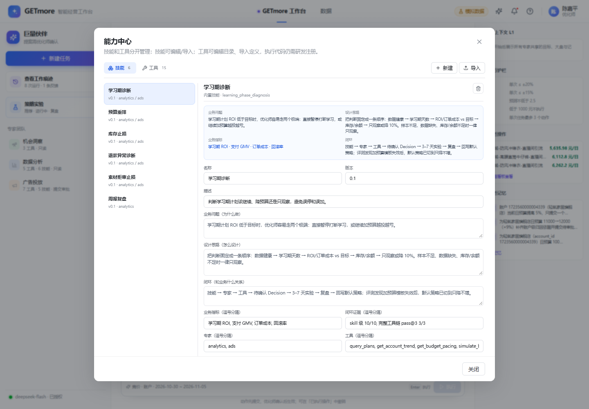

# 能力中心：技能与工具分离

> 目标：技能和工具各自独立，能查看、导入、编辑，但**不把任意 JSON 变成可执行代码**。

---

## 1. 为什么拆

之前：

- 工具定义、handler、专家绑定都在 `server/tools.mjs`；
- 技能硬编码在 `server/skills.mjs`；
- UI 只能看「专家与工具」，不能导入/编辑。

现在：

```text
技能模块                         工具模块
server/skills.mjs                server/tool-registry.mjs
.runtime/partner/skills.json     .runtime/partner/tools.json
        │                                 │
        └──────── 能力中心 UI ────────────┘
                    │
             专家只做绑定
```

---

## 2. 两个模块

### 技能

可编辑：

- id / name / version / description
- businessProblem / designRationale / businessMetrics / closedLoop / evidence
- trigger / steps / instructions / failure
- expertIds / toolNames
- output / evalCaseFile

API：

```text
GET    /partner/skills
POST   /partner/skills
GET    /partner/skills/:id
PUT    /partner/skills/:id
DELETE /partner/skills/:id
```

### 工具

工具分两层：

```text
定义（可查看/导入/编辑）：
  id, name, description, expertIds, parameters, risk, handlerId

执行（代码）：
  handlerId → tools.mjs 里的函数
```

API：

```text
GET    /partner/tools
POST   /partner/tools/import
PUT    /partner/tools/:id
DELETE /partner/tools/:id
```

代码工具：

- 可以编辑目录描述、启用状态；
- 执行逻辑仍在 `tools.mjs`，改代码才改行为。

导入工具：

- 只保存定义；
- `executable=false`、`handlerId=null`；
- 显示「未注册执行」；
- 要执行，必须研发在 `tools.mjs` 注册 handler。

---

## 3. UI

伙伴团队顶部「能力」→ 能力中心：

- **技能 tab**：左侧列表，右侧表单；新建 / 导入 JSON / 编辑 / 保存 / 删除；
- **工具 tab**：左侧列表，右侧描述/参数/执行状态；编辑目录 / 导入定义。



---

## 4. 安全边界

- 技能是 prompt 配置，可以导入/编辑；
- 工具定义可以导入/编辑，但**不能直接执行**；
- 导入工具不会自动出现在专家工具白名单里；
- 工具执行代码仍走 `tools.mjs` 代码评审。

---

## 5. 当前数据

- 技能：6 个（学习期诊断、预算重排、库存止损、退款异常、素材拒审、周报）
- 工具：16 个业务工具（connector + 本地 MCP）
- 数据文件：`.runtime/partner/skills.json`、`tools.json`

---

## 6. 验证

```bash
npm run qa:capability
npm run qa:skill
```

`qa:capability` 会临时改技能/工具，再恢复，不污染演示数据。
