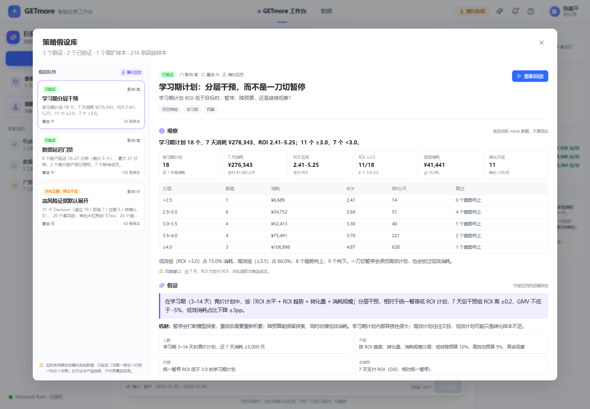
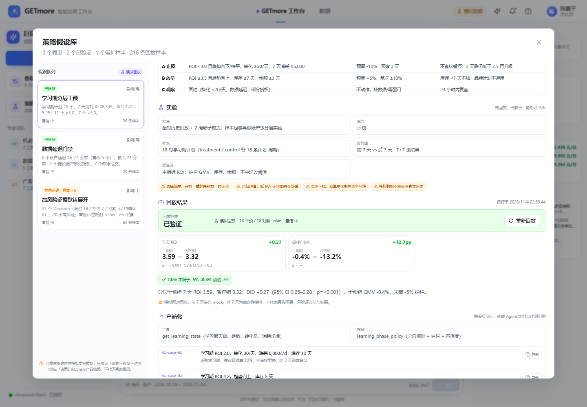
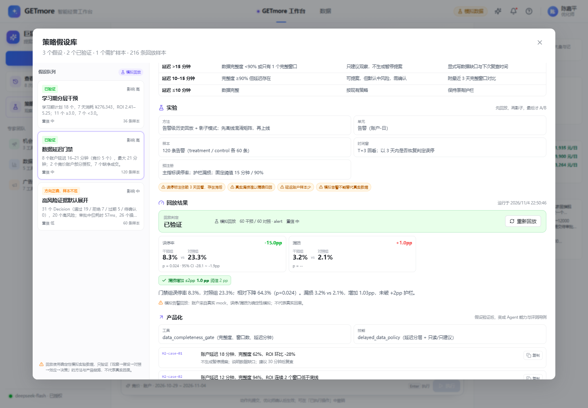
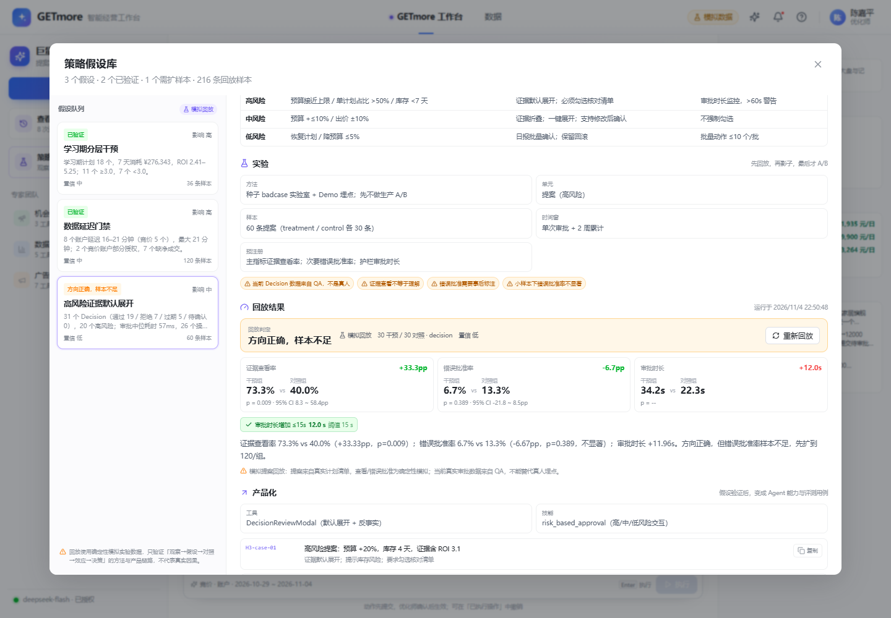

# 策略假设库：从观察，到回放，再到 Agent 能力

> 这是 [策略假设怎么做](strategy-hypothesis-playbook.md) 在 GETmore 里的落地实现。
> **现在它是「研究回放（产品视角）」**：优化师默认入口是「策略实验」（[重设计](strategy-experiment-redesign.md)）；研究回放从策略实验抽屉底部进入，给产品/评测看，不占优化师默认视图。
> API：`GET /partner/hypotheses`、`POST /partner/hypotheses/:id/replay`。

---

## 1. 它解决什么问题

JD 的第一条职责是：

> 分析广告投放表现、AI 投放决策、素材与人群定向效果、历史投放数据等信息，发现可干预机会，参与 Agent 投放策略设计，提出可验证的策略假设。

大多数项目到“我做了个功能”就停了；这个模块补上了中间那层：

```text
观察 → 洞察 → 假设 → 策略 → 实验 → 回放 → 决策规则 → Agent 能力 + 评测用例
```

它不是一个静态报告，而是：

- **可查询**：3 张假设卡，随时打开；
- **可回放**：点「运行回放」，跑对照、算效应、看护栏；
- **可判定**：按预设决策规则给出「已验证 / 方向正确样本不足 / 未通过」；
- **可产品化**：每张卡带工具、技能、评测用例；
- **可审计**：结果落盘 `.runtime/partner/hypotheses.json`。

---

## 2. 一张卡的结构

| 区块 | 内容 |
| --- | --- |
| **观察** | 来自当前 mock 数据：headline、6 个指标、分层表、caveat |
| **假设** | 可证伪的因果陈述 + 机制 + 人群/干预/对照/主指标/护栏/时间窗 |
| **策略** | 分组条件、动作、护栏（A 止损 / B 放量 / C 观察） |
| **实验** | 方法、单元、样本、时间窗、预注册、风险 |
| **回放** | 干预组 vs 对照组、效应、p 值、置信区间、护栏、判定 |
| **产品化** | 工具、技能、3 个评测用例（可一键复制 JSON） |

---

## 3. 三张假设卡

### H1：学习期计划，分层干预而不是一刀切暂停

**观察（当前 mock）**

- 18 个学习期计划，7 天消耗 **¥276,343**，ROI **2.41–5.25**；
- **11 个 ≥3.0**，**7 个 <3.0**；
- 低效组只占 **15.0%** 消耗，高效组（≥3.5）占 **66.0%**；
- 8 个趋势向上，9 个向下。

**假设**

> 在学习期（3–14 天）竞价计划中，按「ROI 水平 + 趋势 + 转化量 + 消耗规模」分层干预，相对于统一暂停低 ROI 计划，7 天后干预组 ROI 高 ≥0.2，GMV 不低于 -5%，低效消耗占比下降 ≥3pp。

**回放（18 对计划，模拟配对）**

| 指标 | 干预组 | 对照组 | 效应 |
| --- | --- | --- | --- |
| 7 天 ROI | 3.59 | 3.32 | **+0.27**（95% CI 0.26–0.28，p<0.001） |
| GMV 变化 | -0.4% | -13.2% | **+12.7pp** |

护栏：GMV 不低于 -5% → 通过。判定：**已验证**（置信中，模拟数据封顶）。

**产品化**：`get_learning_state`、`learning_phase_policy`、3 个评测用例。

---

### H2：数据延迟时，先补数据再提案

**观察（当前 mock）**

- 8 个账户延迟 16–21 分钟，其中竞价 5 个、品牌 3 个；
- 2 个竞价账户部分授权，7 个竞价账户缺净成交；
- 近 14 天延迟账户出现 3 次单日 ROI 跌幅 >20% 的疑似信号（3/51，5.9%），非延迟 7/149（4.7%）。

**假设**

> 对数据延迟 >15 分钟的竞价账户，要求「连续 2 个完整窗口 + 完整度 ≥90%」才允许暂停提案，相对于即时提案，误停率相对下降 ≥30%，漏损增加 ≤2pp。

**回放（120 条告警，treatment / control 各 60）**

| 指标 | 门禁组 | 对照组 | 效应 |
| --- | --- | --- | --- |
| 误停率 | 8.3% | 23.3% | **-15.0pp**（相对下降 64.3%，p=0.024） |
| 漏损 | 3.2% | 2.1% | +1.0pp |

护栏：漏损增加 ≤2pp → 通过（+1.03pp）。判定：**已验证**。

**产品化**：`data_completeness_gate`、`delayed_data_policy`、3 个评测用例。

> 注意：观察里“差异不大，不能证明延迟导致误停”是故意保留的。假设不是从“已证明的事实”开始，而是从“值得验证的风险”开始。

---

### H3：高风险提案，证据默认展开

**观察（当前 `.runtime`）**

- 31 个 Decision：已通过 19 / 已拒绝 7 / 已过期 5 / 待确认 0；
- 20 个高风险（64.5%）；
- 审批中位耗时 **57ms**；26 个操作中 **11 个被撤销**；
- 16 条备注含 `smoke/regression` → 样本来自 QA，不是真人。

**假设**

> 高风险提案默认展开证据 + 反事实对比，相对于默认折叠，真人证据查看率提升 ≥20pp，错误批准率下降 ≥10pp，审批时长增加 ≤15 秒。

**回放（60 条提案，treatment / control 各 30）**

| 指标 | 默认展开 | 默认折叠 | 效应 |
| --- | --- | --- | --- |
| 证据查看率 | 73.3% | 40.0% | **+33.3pp**（p=0.009） |
| 错误批准率 | 6.7% | 13.3% | -6.7pp（p=0.389，不显著） |
| 审批时长 | 34.2s | 22.3s | +12.0s |

护栏：审批时长增加 ≤15s → 通过。判定：**方向正确，样本不足**（置信低）。

**产品化**：`DecisionReviewModal` 默认展开、`risk_based_approval`、3 个评测用例。

> 这是三张卡里最重要的一张：它没有把“方向正确”强行说成“已验证”。错误批准率 p=0.389，样本不够，就该写“需要扩到 120/组”。

---

## 4. 数据与计算

### 4.1 观察

`server/hypotheses.mjs` 从 mock 数据实时计算：

- H1：按 `learningPhase` 筛选竞价计划，取近 7 天消耗/支付/订单，按 ROI 分 5 档；
- H2：按 `dataLagMinutes`、`authorization`、`dataSources` 统计延迟与缺口；用「单日 ROI < 前 3 日均值 ×0.8」定义疑似信号；
- H3：读取 `.runtime/partner/decisions.json` 与 `operations.json`，统计状态、风险、审批耗时、撤销率、QA 备注。

### 4.2 回放

`server/trials.mjs` 生成确定性模拟实验数据：

- **H1**：每个学习期计划取真实前 7 天，配对生成 treatment / control 两个反事实后 7 天；treatment 保留探索（预算 -6%，ROI +0.22），control 暂停（预算 -12%，ROI -0.05）。
- **H2**：用真实延迟账户，生成 120 条告警；treatment 误停 5/60，control 14/60；漏损按 3.2% vs 2.1% 加噪声。
- **H3**：用真实高消耗计划，生成 60 条高风险提案；treatment 证据查看 22/30、错误批准 2/30；control 12/30、4/30。

**所有随机都来自确定性 seed，同一份 mock 每次结果一致。** 这不是真实实验，界面和文档都明确标注「模拟回放」。

### 4.3 统计

- H1：配对 DiD（`post-pre` 的组间差），均值、标准误、95% CI、双侧 p；
- H2/H3：两比例 z 检验，效应、p、相对下降；
- 护栏单独计算，不混进主指标；
- 判定规则预先写在定义里，不由结果反推。

### 4.4 持久化

- 结果写入 `.runtime/partner/hypotheses.json`；
- `GET /partner/hypotheses` 合并「定义 + 观察 + 已存回放」；
- `POST /partner/hypotheses/:id/replay` 重新计算并落盘；
- 重启服务后结果仍在；删除文件即回到「待回放」。

---

## 5. API

```text
GET  /partner/hypotheses
→ { hypotheses: HypothesisCard[], summary, generatedAt, caveat }

POST /partner/hypotheses/:id/replay
→ { ok, hypothesis, summary }
```

`HypothesisCard` 的关键字段：

```ts
{
  id, title, question, tags, impact,
  observation: { headline, summary, metrics, segments, caveat },
  hypothesis: { statement, mechanism, population, intervention, control, primaryMetric, guardrail, horizon, decisionRule },
  strategy: [{ group, condition, action, guardrail }],
  test: { method, unit, sample, window, preRegistration, risks },
  evidence: { synthetic, sample, metrics, guardrails, verdict, confidence, summary, caveat } | null,
  productization: { tool, skill, evalCases }
}
```

---

## 6. UI

入口：巨量伙伴左侧「策略实验」→ 抽屉底部「研究回放（产品视角）」。

- 左栏：3 张卡，显示状态、影响、置信、样本数、观察摘要；
- 右栏：观察 → 假设 → 策略 → 实验 → 回放 → 产品化；
- 顶部：状态、影响、置信、模拟标记、运行/重新回放；
- 回放：干预组 vs 对照组、效应、p、CI、护栏、判定、caveat；
- 评测用例：一键复制 JSON。

截图：









---

## 7. 怎么加一张新假设

以「净成交口径门禁」为例：

1. **在 `server/hypotheses.mjs` 的 `DEFINITIONS` 里加一条**：id、标题、问题、机制、人群、干预、对照、主指标、护栏、决策规则、策略、实验、产品化。
2. **加观察函数**：从 mock 数据算指标；在 `buildObservation` 里路由。
3. **在 `server/trials.mjs` 加 trial 生成器**：定义 treatment/control、样本、outcome；在 `buildTrials` 里返回。
4. **加 evidence 函数**：算效应、p、CI、护栏；在 `computeEvidence` 里路由。
5. **加评测用例**：`productization.evalCases`，3–5 条即可。
6. **跑 `node scripts/hypothesis-check.mjs`**：验证结构、数值、判定、持久化。
7. **UI 不用改**：卡片是通用的，只要字段 shape 不变。

> 假设库和评测集是同一套资产：每验证一个假设，就把它变成 3–5 个评测用例；每推翻一个假设，就把它变成反例。

---

## 8. 边界与诚实

- **回放是模拟实验**：`synthetic: true`，置信度最高只到「中」；不能对外说“这个策略提升了 ROI”。
- **观察是 mock 数据**：结构真实、数值模拟；H3 的 Decision 来自 QA，不是真人。
- **没有真实因果**：真实实验需要历史回放、影子、分层随机；这个模块验证的是「方法 + 产品链路」。
- **不能替代评测**：回放只证明“假设值得继续测”，不证明 Agent 在真实场景一定做对。

---

## 9. 演示脚本（30 秒）

1. 进入巨量伙伴，点左侧「策略实验」→ 抽屉底部「研究回放（产品视角）」。
2. 看 H1：18 个学习期计划、27.6 万消耗、ROI 2.41–5.25；说明“一刀切会误伤”。
3. 点「运行回放」：3.59 vs 3.32，DiD +0.27，GMV -0.4% vs -13.2%，判定「已验证」。
4. 切 H3：看「方向正确，样本不足」——证据查看率 +33.3pp，但错误批准率 p=0.389，主动说“样本不够，扩到 120/组”。
5. 点评测用例「复制」，说明“假设会变成评测集”。

---

## 10. 验证

```bash
npm run qa:hypothesis
```

检查：

- 3 张卡、≥200 条回放样本；
- 每张卡有观察、策略、实验、风险、评测用例；
- H1 效应 ≥0.2、H2 误停率显著下降、H3 证据查看率 ≥20pp；
- 所有数值 finite，无 NaN/undefined；
- 结果落盘，重启后仍在。

UI 检查：`node scripts/hypothesis-ui-check.mjs`（默认访问 `http://127.0.0.1:5178`，可用 `APP_URL` 覆盖；需要先启动 partner 与 Vite）。
